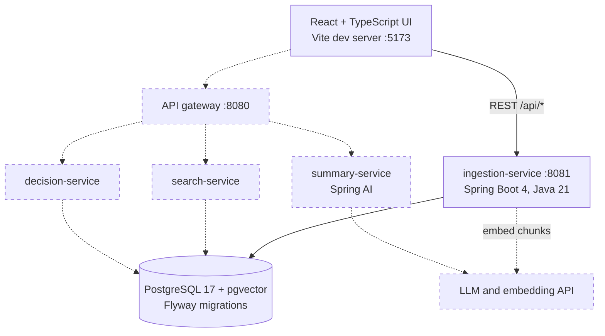
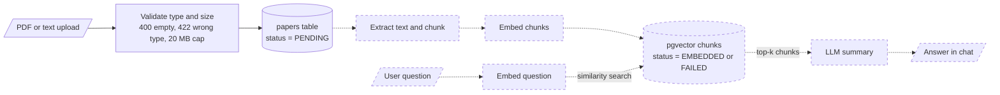
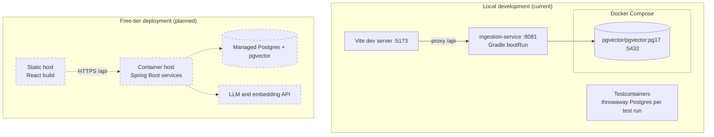

# Research Agent

A retrieval-augmented (RAG) research assistant that helps you read, search and keep track of academic papers. Upload PDFs, ask questions across them, and record the decisions you make as you go.

> **Status:** in progress. Paper upload and the chat UI implemented (chat replies are mocked for now). Embeddings, semantic search and LLM summaries are planned. See [Roadmap](#roadmap).

## Architecture

Solid boxes and arrows implemented. Dashed ones are planned.

### System



- **ingestion-service:** upload, list and fetch papers (`POST /api/papers`, `GET /api/papers`, `GET /api/papers/{id}`), with paper status tracking.
- **common:** shared Gradle module for code used across services.

### Data flow



### Deployment



## Tech stack

| Layer | Choice |
|---|---|
| Backend | Java 21, Spring Boot 4, Spring Data JPA, Flyway |
| Database | PostgreSQL 17 with pgvector (Docker Compose locally) |
| AI (planned) | Spring AI for pluggable LLM and embedding providers |
| Frontend | React, TypeScript, Vite |
| Testing | JUnit 5, Spring MockMvc, Testcontainers (real Postgres in tests) |

## Design choices

- **Real database in tests.** Integration tests run against PostgreSQL in Testcontainers, not an in-memory stand-in, so SQL and pgvector behave as in production.
- **Schema owned by migrations.** Flyway creates the schema and Hibernate only validates it (`ddl-auto: validate`), so the code can't silently change the database.
- **Standard error responses.** Errors use RFC 7807 problem details, and uploads are capped at 20 MB.
- **Decisions on record.** Each major choice is written up as an ADR in [`docs/adr`](docs/adr).

## Run locally

Requirements: Java 21 (see `.sdkmanrc`), Docker, Node 22+.

```bash
docker compose up -d                 # PostgreSQL + pgvector on :5432
./gradlew :ingestion-service:bootRun # API on :8081
cd frontend && npm install && npm run dev  # UI on :5173, proxies /api to :8081
```

Run the tests (Docker must be running for Testcontainers):

```bash
./gradlew test
```

## Roadmap

- [x] Paper upload, listing and status tracking
- [x] Integration tests against a real Postgres (Testcontainers)
- [x] Chat UI with upload flow (replies mocked)
- [ ] Chunk and embed papers into pgvector
- [ ] Semantic search API with p95 latency benchmark
- [ ] LLM summaries of related work through Spring AI
- [ ] Persist research decisions and a progress dashboard
- [ ] Free-tier live deployment
